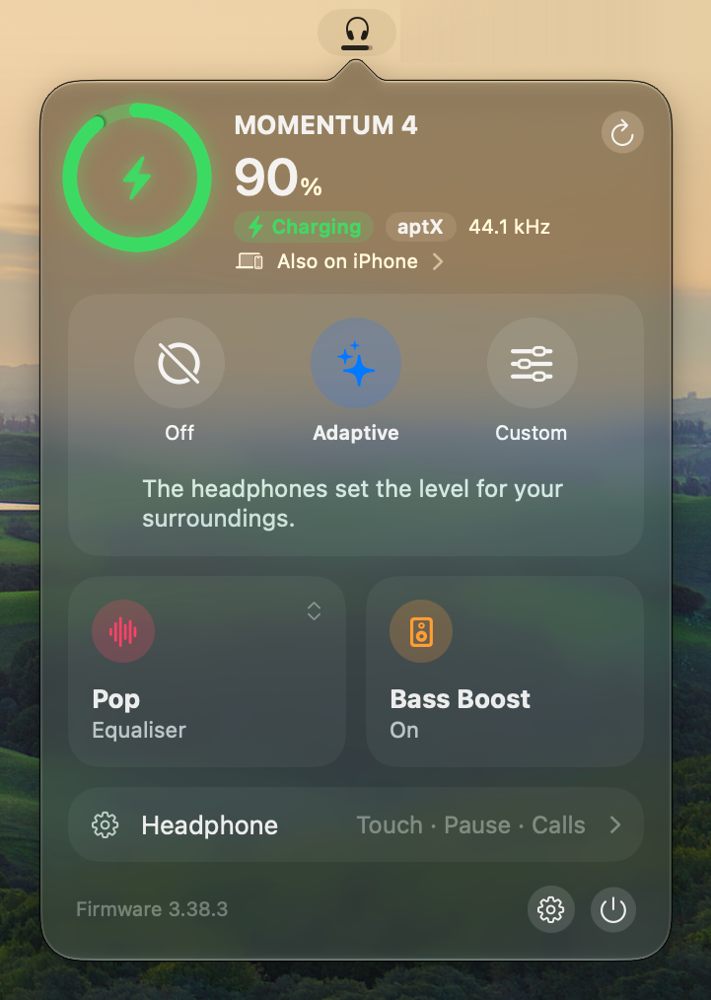
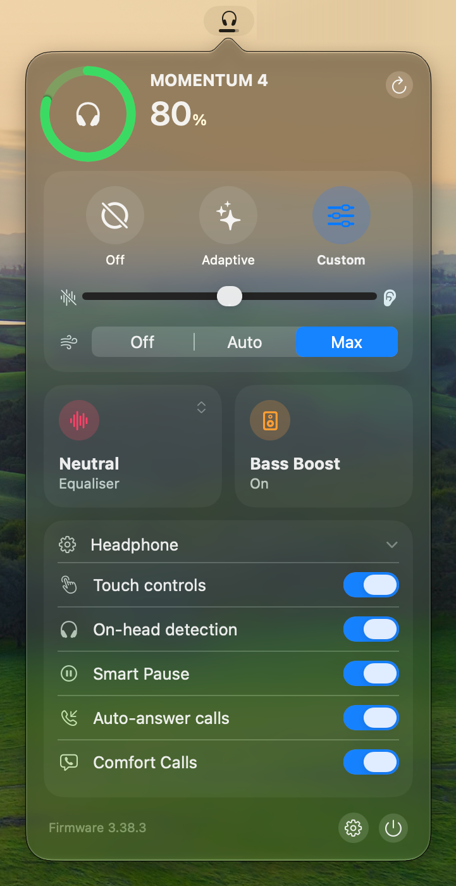
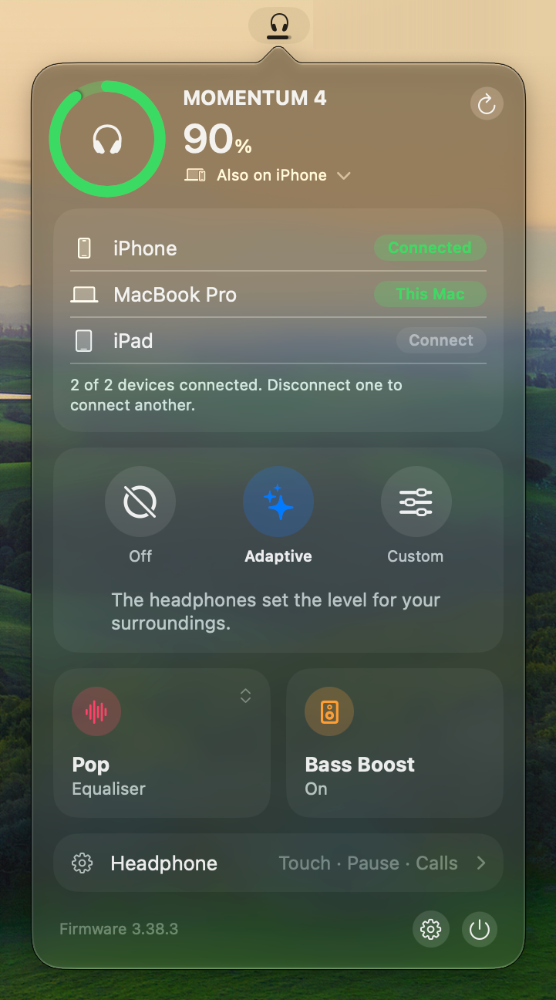
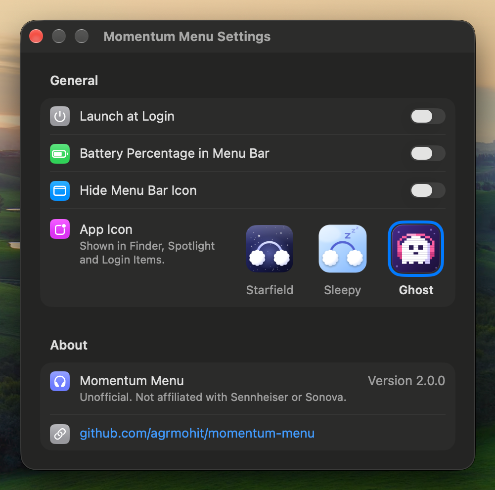
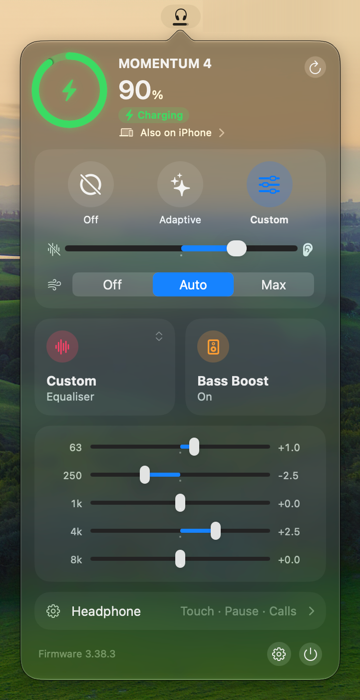
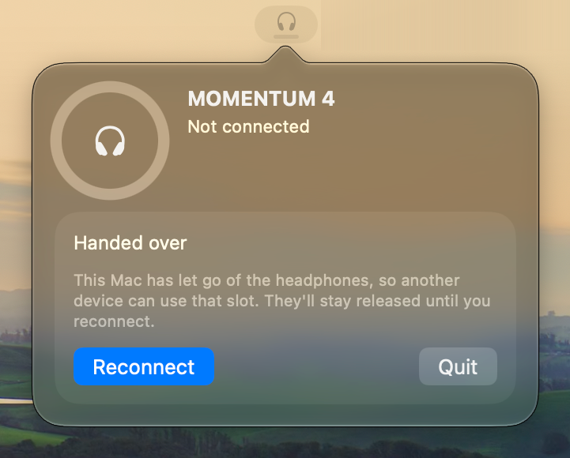
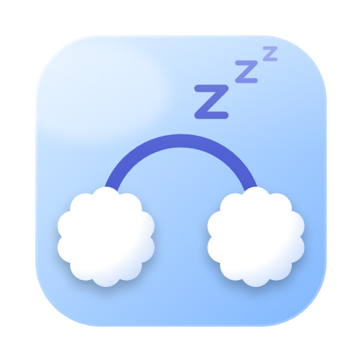

# Momentum Menu

A menu bar app for the Sennheiser MOMENTUM 4. It does almost everything Smart Control Plus does, right from your Mac, so your phone can stay in your pocket. Needs macOS 26 on Apple silicon.

[](https://www.aihonestybadge.com)
[](LICENSE)
[](https://github.com/agrmohit/momentum-menu/releases/latest)
[](#download)

<!-- One row of three columns, two shots each, paired so the columns end near level. -->
<table>
  <tr>
    <td valign="top" align="center">
      <br>Charging<br><br>
      <br>Headphone settings
    </td>
    <td valign="top" align="center">
      <br>Paired devices<br><br>
      <br>Settings
    </td>
    <td valign="top" align="center">
      <br>Equaliser bands<br><br>
      <br>Disconnected
    </td>
  </tr>
</table>

Pick one of three app icons in Settings:

<table>
  <tr>
    <td align="center"><br>Starfield</td>
    <td align="center"><br>Sleepy</td>
    <td align="center"><br>Ghost</td>
  </tr>
</table>

## How it behaves

<table>
  <tr>
    <td width="50%" valign="top">🎧 <b>Put them on.</b> They connect in about a second, with the battery and codec right there.</td>
    <td width="50%" valign="top">📱 <b>Switch to your phone.</b> Hand them over, and the app leaves them alone until you ask.</td>
  </tr>
  <tr>
    <td valign="top">📞 <b>Take a call.</b> The call codec shows, and auto-answer and Comfort Calls are a click away.</td>
    <td valign="top">📶 <b>Bluetooth blips.</b> Off and on within half an hour, and they come back by themselves.</td>
  </tr>
  <tr>
    <td valign="top">🔀 <b>Use two devices.</b> See what else is connected, then connect or disconnect it here.</td>
    <td valign="top">🧹 <b>Retire an old phone.</b> Right-click it, confirm, and the headphones forget it for good.</td>
  </tr>
  <tr>
    <td valign="top">🔋 <b>Plug in to charge.</b> A softly pulsing bolt fills the battery ring until it says Charged.</td>
    <td valign="top">🛡️ <b>Get new firmware.</b> Anything that could erase a pairing waits until it is tested.</td>
  </tr>
</table>

## All the usual controls

Everything you would change in Smart Control Plus day to day is here too:

- **Noise:** Off, Adaptive or Custom with a level slider, plus anti-wind.
- **Sound:** Sennheiser's eight equaliser presets, three of our own, five band sliders and Bass Boost.
- **Headphones:** touch controls, on-head detection, Smart Pause, auto-answer and Comfort Calls.
- **Devices:** the line under the battery lists your paired devices, and Settings picks an icon for each.

<details>
<summary><b>🛡️ Built to be trusted</b>: allow-list, model check, tested firmware, verified builds, offline</summary>

<table>
  <tr>
    <td width="50%" valign="top">✅ <b>Allow-list.</b> The app only sends commands it knows, with the exact bytes it expects.</td>
    <td width="50%" valign="top">🎯 <b>Model check.</b> It writes nothing until the headphones confirm they are a MOMENTUM 4.</td>
  </tr>
  <tr>
    <td valign="top">🔬 <b>Tested firmware only.</b> Anything that could erase a pairing runs only on firmware 3.38.3.</td>
    <td valign="top">🏁 <b>Latest click wins.</b> Click quickly and the headphones still end up where you left them.</td>
  </tr>
  <tr>
    <td valign="top">🔏 <b>Verified builds.</b> Each DMG is built by GitHub Actions, with an attestation you can check.</td>
    <td valign="top">🧾 <b>Readable crashes.</b> Each release ships the symbols that turn a crash report into names.</td>
  </tr>
  <tr>
    <td valign="top">📴 <b>Offline by design.</b> It talks to your headphones, and to GitHub only when you ask for updates.</td>
    <td valign="top">👤 <b>No account.</b> No sign-in, no Sennheiser account and no analytics of any kind.</td>
  </tr>
</table>

</details>

<details>
<summary><b>🍎 A proper Mac app</b>: macOS 26 look, menu bar battery, launch at login, three icons</summary>

<table>
  <tr>
    <td width="50%" valign="top">🧩 <b>Feels like macOS 26.</b> It sits in the Liquid Glass popover, made of Apple's own controls.</td>
    <td width="50%" valign="top">🌓 <b>Follows your settings.</b> Dark Mode, Reduce Transparency and Increase Contrast all work.</td>
  </tr>
  <tr>
    <td valign="top">💯 <b>Battery in the menu bar.</b> Show the percentage by the icon, or hide the icon instead.</td>
    <td valign="top">🚀 <b>Launch at login.</b> Turn it on once in Settings, and it is there after every restart.</td>
  </tr>
  <tr>
    <td valign="top">🎨 <b>Three app icons.</b> Starfield, Sleepy or Ghost, shown wherever macOS shows the app.</td>
    <td valign="top">⌨️ <b>Keyboard.</b> <code>⌘,</code> opens Settings, <code>⌘W</code> closes it, and <code>⌘Q</code> quits the app.</td>
  </tr>
</table>

</details>

**What's not here:** firmware updates, Sound Check, Sound Personalization, Sound Zones, Find Headphones and the multipoint switch. They need a Sennheiser account, your location or Sennheiser's servers, so keep Smart Control Plus for those.

> [!CAUTION]
> **Unofficial and reverse-engineered.** Use it at your own risk. Not made, endorsed or supported by Sennheiser or Sonova. The control protocol is undocumented, every command comes from community captures, and a firmware update can change what one does.

## Download

1. Download the `.dmg` from the [latest release](https://github.com/agrmohit/momentum-menu/releases/latest).
2. Open it and drag **Momentum Menu** to **Applications**.
3. Open Momentum Menu. macOS shows **"MomentumMenu.app" Not Opened**. Press **Done**, not the blue button.
4. Open **System Settings > Privacy & Security** and scroll down to **Security**. Next to **"MomentumMenu.app" was blocked to protect your Mac**, press **Open Anyway**, then confirm with Touch ID or your password.
5. macOS asks once more: **Open "MomentumMenu.app"?** Press **Open Anyway**. The blue button would move the app to the Bin.
6. Allow Bluetooth when asked. The app needs it to talk to the headphones.

Steps 3 to 5 are needed once, because the app is ad hoc signed, not notarised by Apple. In Terminal, `xattr -dr com.apple.quarantine /Applications/MomentumMenu.app` does the same.

Left click the menu bar icon for the popover, right click for Settings, Check for Updates, Refresh, Disconnect and Quit.

### Check the download

Each DMG is built by GitHub Actions from the tagged commit, with a build provenance attestation, a SHA-256 file and a dSYM zip for reading crash reports ([For developers](#for-developers)). Every DMG's attestation is listed on the [attestations page](https://github.com/agrmohit/momentum-menu/attestations), with its commit and workflow. To check a download:

```sh
gh attestation verify MomentumMenu-*.dmg -R agrmohit/momentum-menu
gh release verify-asset MomentumMenu-*.dmg -R agrmohit/momentum-menu
```

The first checks the build provenance; the second checks the file belongs to the latest release. Name a tag before the file to check an older one. Passing both does not skip steps 3 to 5: macOS checks for Apple notarisation, not attestations.

## For developers

<details>
<summary><b>Build and run</b></summary>

Needs macOS 26 and Xcode 26 (the Command Line Tools lack the SwiftUI macro plugin and XCTest).

```sh
make install    # builds, signs ad hoc, installs to ~/Applications
make check      # clean build with warnings as errors, then the tests; what CI runs
make            # every target and variable
```

- The ad hoc signature changes on every build, so macOS may ask for Bluetooth permission again after an install.
- For screenshots, `defaults write com.agrmohit.momentummenu demoDeviceNames -bool YES` shows stock device names until `defaults delete` and a relaunch.
- The app sets the chosen app icon again at launch, since an install replaces it. A non-default icon adds a Finder attribute that fails `codesign --strict`; the plain check passes.
- `make icons` redraws the app icons from `Resources/AppIcon/artwork.js`, and the DMG's volume icon, background and window layout from that and `Resources/DMG/layout.json` (needs Chrome, oxipng and uv). With the same Chrome and macOS, every run is byte-identical; commit what it writes.
- Every GAIA frame goes to the unified log at debug level, which macOS does not keep. Watch it live with `log stream --level debug --predicate 'subsystem == "com.agrmohit.momentummenu"'`.
- The tests need no hardware. `make test` is the quick incremental run; it shows a file's warnings only when it recompiles that file.
- After a firmware update, Disconnect and Forget for other devices stay off until the new version is tested: [Re-testing pairing commands on new firmware](docs/firmware-retest.md).
- A release is a `v*` tag on a commit whose `build.sh` version matches and which has `docs/releases/<tag>.md`. CI runs first, then the release workflow builds, attests and publishes the DMG.

</details>

<details>
<summary><b>Crash reports</b></summary>

If the app crashes, macOS saves a report as `~/Library/Logs/DiagnosticReports/MomentumMenu-<date>.ips`; Console > Crash Reports shows the same list. Attach it to an [issue](https://github.com/agrmohit/momentum-menu/issues).

The released binary is stripped, so a report shows the app's frames as addresses. Each release's `MomentumMenu-<version>.dSYM.zip` (debug symbols) turns them back into functions and lines. To read a report:

1. Download the dSYM for the version on the report's first line (`app_version`), and unpack it:

   ```sh
   gh release download v2.2.1 -R agrmohit/momentum-menu -p '*.dSYM.zip'
   ditto -x -k MomentumMenu-2.2.1.dSYM.zip .
   ```

2. Check its UUID against the `uuid` of the `MomentumMenu` entry in the report's `usedImages`:

   ```sh
   dwarfdump --uuid MomentumMenu.dSYM
   ```

   **Only a matching dSYM works.** Another build's dSYM can give wrong names, and rebuilding the tag need not reproduce the UUID.

3. Resolve a frame. The load address is that image's `base`; a frame's address is `base` plus its `imageOffset`:

   ```sh
   atos -arch arm64 -o MomentumMenu.dSYM/Contents/Resources/DWARF/MomentumMenu -l <base> <address>
   ```

> [!NOTE]
> On a Mac that has built the app, Spotlight indexes the local `build/MomentumMenu.dSYM`, so `atos` can name frames without being given the right dSYM. To see which symbols are really in use, run `lldb <binary>` and then `image list -S MomentumMenu`.

</details>

<details>
<summary><b>Protocol notes</b></summary>

GAIA v3 frames start `FF 03 00 LL`, then the vendor (`0x0495`) and the command id. The feature is `command >> 9`.

| What | Ids | Notes |
| --- | --- | --- |
| Subscribe | `0x0007` | The device pushes nothing for a feature until it is registered. The app registers battery, ANC, EQ, transparency, audio (feature 4) and device management (feature 10). |
| Battery | `0x0603` | Steps of 10 only. HFP and Qualcomm's `001D:1A01` give the same steps, so finer is not possible. |
| Codec | `0x0800` read, `0x0880` push | One byte, Smart Control's enum: 0 SBC, 1 AAC, 2 aptX, 3 aptX LL, 5 aptX HD, 8 aptX Adaptive, 9 aptX Lossless, 10 LC3, `FF` none. 11 is seen but unexplained. |
| Sample rate | `0x089A` push | u32 big-endian Hz. Covers whichever device is streaming. |
| Noise mode table | `0x1A00` | Adaptive is written as an `[id, value]` pair, or the whole table where the pair is rejected; anti-wind always as the whole table. A write can reset the level, so the app skips no-op writes and reads the level back after the rest. |
| EQ and bass boost | `0x10xx` | Firmware 3.x only; 2.x rejects them with `0x05`. |
| Paired devices | `0x1400`-`0x1409`, `0x1484` push | Count, own index, limit (2), then `[index, priority, connected, name, 00]` per index. Addressed by index only, and indexes can reorder, so the list is re-read before any connect (`0x1402`), disconnect (`0x1403`) or forget (`0x1405`). A slot a forget emptied answers `FF FF FF 00` and is left out of the count, so the read goes on past it. |

Safety lives in [`Commands.swift`](Sources/M4Core/Gaia/Commands.swift):

- An allow-list of every id the app sends, with exact payload rules. Anything else is refused before it reaches the radio.
- A deny-list underneath: `0x0607`, `0x0613` and `0x0685` drop the link. `0x0801`, `0x0805` and `0x0817` are setters the app does not use. Never send anything in `0x06xx` but the battery read: `0x0605` with an empty payload powered the headphones off three times.
- `0x1403` disconnects a paired device on firmware 3.38.3 but erased a pairing on 2.13.42. The pairing commands can change meaning between firmware versions, so `0x1403` and `0x1405` are sent only on 3.38.3, the version they were tested on.
- `0x1405` forgets one paired device that is not connected. On 3.38.3 it answers `00` and leaves an empty slot that answers `FF FF FF 00` and drops out of the count; a restart closes the gap. The list is re-read until the name is gone. `0x1406` deletes every pairing and is never sent.
- Frames for any vendor other than `0x0495` are refused.
- Never sweep id ranges against real headphones.

</details>

## Credits

- [andr3-santos/momentum-menu](https://github.com/andr3-santos/momentum-menu): the repo this is forked from.
- [DanSmith888/omarchy-momentum4](https://github.com/DanSmith888/omarchy-momentum4): `PROTOCOL.md`, the presets and the hazard list.
- [gjabell/momentumctl](https://github.com/gjabell/momentumctl): frame format and the captured test vectors.
- [Ariazonaa/momentum-control](https://github.com/Ariazonaa/momentum-control) (was `momentum4-control`): the GAIA SDP service UUID, EQ payloads, and the multipoint commands and captures.
- [xndbogdan/sennheiser-control](https://github.com/xndbogdan/sennheiser-control): the device model from Smart Control, including the forget command `0x1405`.
- [kunalagra/OtoControl](https://github.com/kunalagra/OtoControl): Smart Control Plus's notes on gaps left by a forget.
- [stefanfmeyer/smart-connect-bt-audio](https://github.com/stefanfmeyer/smart-connect-bt-audio): GAIA over BLE and cross-checked ids.

Not affiliated with Sennheiser or Sonova.

## License

[MIT](LICENSE)
