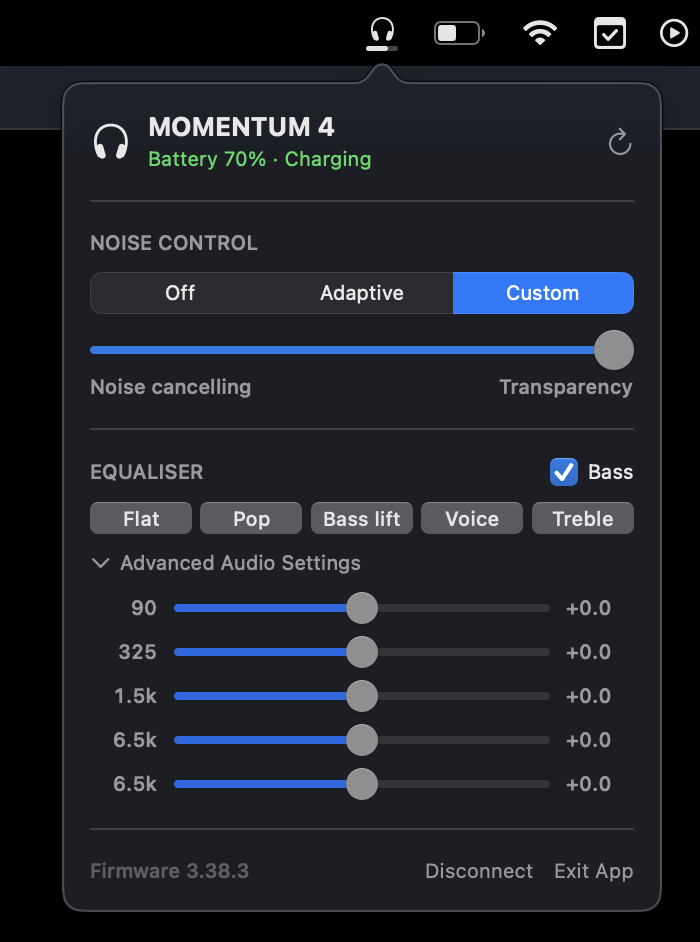

# Momentum Menu

A macOS menu bar app for Sennheiser MOMENTUM 4 Wireless headphones.

Sennheiser's Smart Control Plus app is iPhone-only — the App Store listing says
"Only for iPhone", so it is not offered on Apple Silicon Macs either. This is a
small native alternative for the things you actually reach for day to day:
battery, noise control and the equaliser.

<p align="center">
  
</p>

**Not affiliated with, endorsed by, or supported by Sennheiser or Sonova.**
Sennheiser and MOMENTUM are trademarks of their respective owners. This project
is an independent, interoperable client for headphones you already own.

> [!WARNING]
> This talks to your headphones over a protocol nobody published. It is built
> from community reverse-engineering plus verification against real hardware.
> It can misbehave on firmware it has not seen. Use it at your own risk.

## Quick setup

```sh
brew install --cask --no-quarantine andr3-santos/momentum-menu/momentum-menu
open -a MomentumMenu
```

`--no-quarantine` is not optional. The app is ad-hoc signed rather than
notarised with a paid Apple Developer account, so macOS quarantines it on
download and refuses to open it. The flag tells Homebrew not to attach that
quarantine flag in the first place. Without it you would have to run
`xattr -dr com.apple.quarantine /Applications/MomentumMenu.app` afterwards.

Or build it yourself, which takes a few seconds and sidesteps Gatekeeper
entirely, because software you compile locally is never quarantined:

```sh
git clone https://github.com/andr3-santos/momentum-menu.git
cd momentum-menu && ./build.sh release install
open -a MomentumMenu
```

That needs macOS 14+ and Xcode's Swift toolchain, and installs to
`~/Applications`. macOS asks for Bluetooth permission on first launch.

> [!NOTE]
> Pick one or the other. Homebrew installs to `/Applications` and `build.sh`
> to `~/Applications`; having both leaves two bundles with the same identifier
> and `open -a MomentumMenu` will pick whichever Launch Services prefers.

## Status

Verified against a MOMENTUM 4 Wireless on this Mac:

| Feature | State |
| --- | --- |
| Battery level | works |
| Charging indicator | works |
| Noise control mode (Off / Adaptive / Custom) | works |
| Noise level slider (ANC ↔ transparency) | works |
| Touch-control state (read) | works |
| Firmware version | works |
| Equaliser (5-band, presets) | works — **needs headphone firmware 3.x** |
| Bass boost | works — **needs headphone firmware 3.x** |
| Disconnect (frees a multipoint slot) | works |
| Settings: launch at login, hide icon, update checks | works |

Verified against a MOMENTUM 4 Wireless on firmware 3.38.3, and previously on
2.13.42.

### The device tells you nothing unless you subscribe

GAIA devices answer questions, but volunteer nothing to a client that has not
registered. Command `0x0007` subscribes to one feature, by id, and GAIA v3
packs the feature into the command itself — `feature = command >> 9`. So
charging (`0x0682`) is feature 3, ANC (`0x1A05`) is 13, the equaliser
(`0x1003`) is 8.

This app subscribes to battery, ANC, equaliser and transparency at connect.
Two things follow:

- **Charging is known immediately.** There is no getter for it, but the device
  pushes the current state the moment you subscribe, so it does not have to
  wait for the cable to move. The icon shows it as a slow pulse rather than a
  bolt: at 2.5pt tall a bolt is an unreadable smudge, and motion survives the
  size.
- **The menu stays honest.** Change ANC, the equaliser or bass boost from the
  phone app and the device pushes it here, instead of the menu being stale
  until the next poll.

Without that subscription the headphones look broken in a very convincing way:
every request is answered correctly and nothing is ever announced.

### The firmware 3.x gate

The parametric equaliser and bass boost were added in headphone firmware 3.x.
On 2.x the device rejects those command ids outright, and nothing a host sends
can work around it — the commands do not exist there yet. This was settled by
asking the hardware rather than guessing: on a unit running 2.13.42, `0x1000`
and `0x1003` are rejected with `0x05` whether sent empty or with an argument
byte, and `0x1009` (bass boost) answers `0x01`.

That matters because `0x05` is ambiguous on this device: it means *either*
"unsupported" *or* "this getter needs an argument and you sent none" — some ids
really do answer only when given a dummy byte. `--probe --diagnose` sends each
one both ways so the two cases can be told apart.

The app reads the firmware version at connect and gates the feature on it, so
on 2.x the equaliser section explains what is needed and names your installed
version, and on 3.x it populates itself. No app update is required when you
update the headphones.

## Using it

Left click the menu bar icon for battery, noise control and the equaliser.
Right click for Settings, update checks and Exit App.

The icon is a headphones glyph over a battery bar — deliberately not a bare
headphones glyph, which is what macOS already shows in its own Sound item
whenever headphones are the output device. The bar sweeps while connecting
(which can take a few seconds) and pulses while charging.

Equaliser presets are up front; the five parametric band sliders are one click
deep under **Advanced Audio Settings**, since per-band gains are not what a
menu bar is for. Gain limits come from the device: a MOMENTUM 4 on 3.38.3
allows ±6.0 dB.

**Disconnect** drops this Mac's Bluetooth link entirely, rather than just the
control channel, so one of the headphones' two multipoint slots is freed for
another device. The two-link ceiling is in the headphones' own firmware and no
host can raise it, so handing a slot over is the only way to involve a third
device. The app will not reconnect by itself afterwards — that would take back
the slot you just gave away — so use **Reconnect** when you want them again.

**Hide menu bar icon** leaves the app running with nothing to click. Opening
Momentum Menu again reopens Settings, which is how you turn the icon back on.

## Explicitly out of scope: firmware updates

This app will never write firmware. A malformed firmware write over a
reverse-engineered protocol bricks the headphones, and there is no recovery
path. Use Sennheiser's own app for firmware.

## Safety

Several GAIA command ids are actively dangerous on this hardware. They are
hard-blocked in [`Commands.swift`](Sources/M4Core/Gaia/Commands.swift), enforced
centrally so no call site can route around the check, and covered by tests:

| Id | Why it is blocked |
| --- | --- |
| `0x0607` | Takes the headphones offline; they need a power cycle to come back |
| `0x0613`, `0x0685` | Reset the control link |
| `0x1403` | **Silently erases a pairing.** It wiped a phone's pairing during someone's indexed scan |
| `0x0801`, `0x0805`, `0x0817` | Act on a paired-device index, effect unknown |
| all other `0x06xx` | Power/system group, known to reset the link. Only battery (`0x0603`) is allowed out of it |

If you extend this, do not sweep command ranges against your own headphones
without reading the protocol notes linked below first. Those warnings were paid
for by other people's hardware.

## Requirements

- Apple Silicon or Intel Mac on macOS 14 or later
- Xcode 15+ (for the Swift toolchain)
- MOMENTUM 4 paired to the Mac

## Build

```bash
./build.sh                  # produces build/MomentumMenu.app
./build.sh release install  # and copies it to ~/Applications
```

Once installed it launches by name with `open -a MomentumMenu`. Otherwise:

```bash
# read-only check: reads state, writes nothing
open -W --stdout /dev/stdout build/MomentumMenu.app --args --probe

# add the payload-form diagnostic
open -W --stdout /dev/stdout build/MomentumMenu.app --args --probe --diagnose

# run the menu bar app
open build/MomentumMenu.app
```

Launch it with `open`, not by running the binary directly. macOS attributes a
privacy request to the *responsible process*, so running the executable from a
shell makes your terminal responsible — and since the terminal has no Bluetooth
usage description, the process is killed on its first Bluetooth call.

The app is ad-hoc signed. On first launch macOS will ask for Bluetooth
permission, and Gatekeeper may need a right-click → Open.

## Project layout

```
Sources/M4Core/Gaia/          frame codec, command ids, safety blocklist
Sources/M4Core/Transport/     IOBluetooth RFCOMM channel
Sources/M4Core/Controller/    device state, request/response matching
Sources/MomentumMenu/         NSStatusItem + SwiftUI popover
Tests/                        codec, blocklist and gain-encoding tests
```

Run the tests with `swift test`. They cover the wire format against captured
frames and need no hardware.

## Credits

The protocol work is not mine. This app is a Swift implementation built on
documentation and code from these projects, and would not exist without them:

- [DanSmith888/omarchy-momentum4](https://github.com/DanSmith888/omarchy-momentum4)
  — `PROTOCOL.md`, verified against firmware 3.38.3. The source of the command
  tables, the EQ gain scaling, and every one of the hazard warnings above.
- [gjabell/momentumctl](https://github.com/gjabell/momentumctl) (MIT) — frame
  format and the captured test vectors this project's codec tests use.
- [Tumult1337/momentum4-control](https://github.com/Tumult1337/momentum4-control)
  (MIT) — the GAIA SDP service UUID, EQ payload shapes, and independent
  confirmation of the command set.
- [stefanfmeyer/smart-connect-bt-audio](https://github.com/stefanfmeyer/smart-connect-bt-audio)
  — GAIA over BLE GATT, and cross-verification of command ids.

Where those sources disagree — notably the payload format for the noise-mode
table at `0x1A00`, where one sends a single `[id, value]` pair and another says
the device requires the whole table — this app tries the short form, and on
rejection falls back to read-modify-write and remembers the answer.

## License

[MIT](LICENSE)
