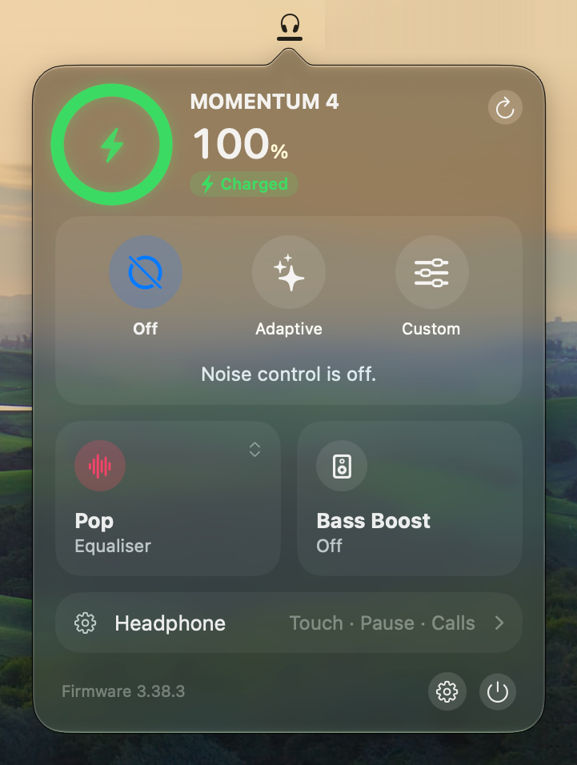
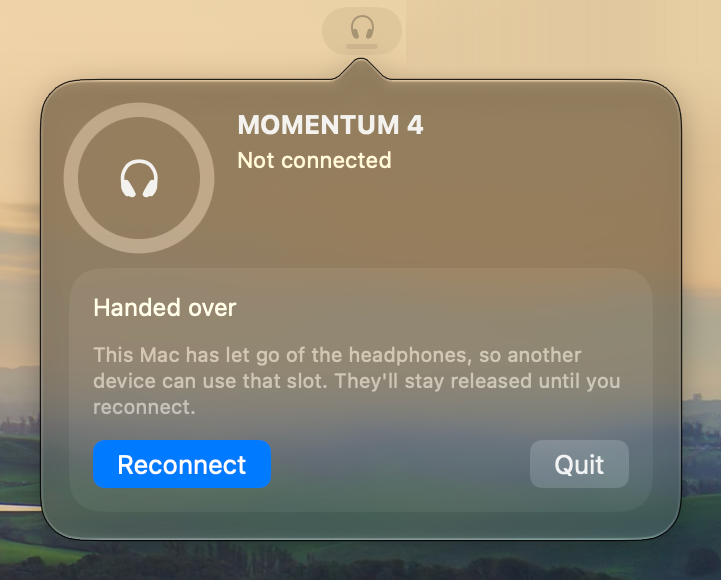
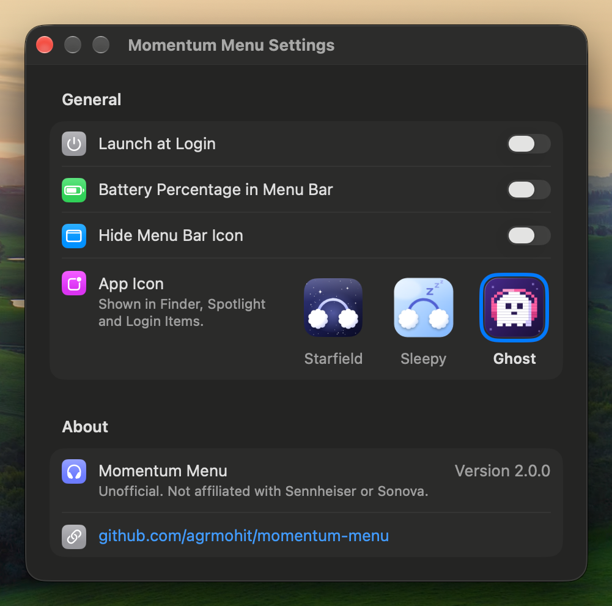
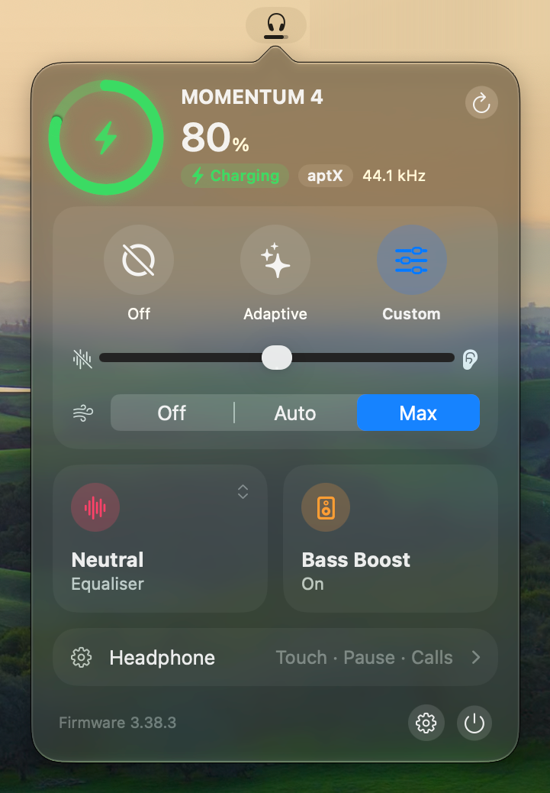
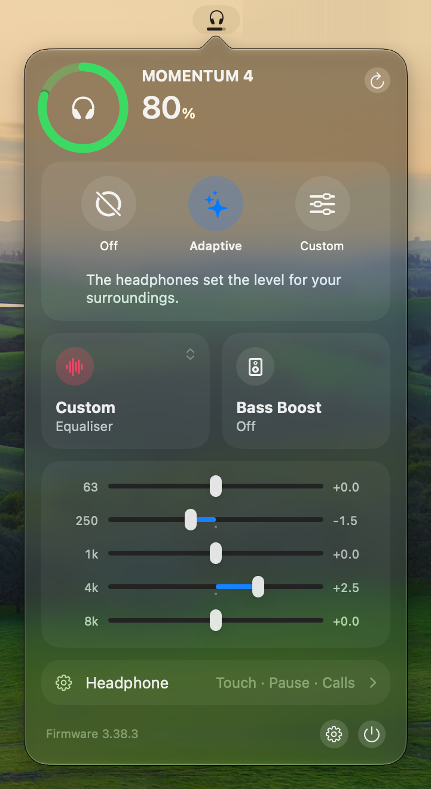
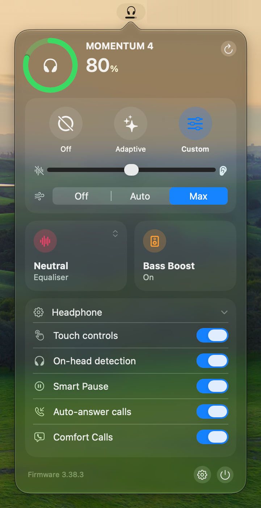

# Momentum Menu

A macOS menu bar app for the Sennheiser MOMENTUM 4.

<table>
  <tr>
    <td valign="top" align="center"><br>Charged</td>
    <td valign="top" align="center"><br>Handed over</td>
    <td valign="top" align="center"><br>Settings</td>
  </tr>
  <tr>
    <td valign="top" align="center"><br>Charging</td>
    <td valign="top" align="center"><br>Equaliser bands</td>
    <td valign="top" align="center"><br>Headphone settings</td>
  </tr>
</table>

> [!WARNING]
> The protocol is reverse-engineered. Never send anything in `0x06xx` other than the battery read: `0x0605` with an empty payload powered the headphones off three times. See [Protocol notes](#protocol-notes).

## Build and run

Needs macOS 26 and Xcode 26 (the Command Line Tools lack the SwiftUI macro plugin and XCTest).

```sh
./build.sh release install    # builds, signs ad hoc, installs to ~/Applications
open -a MomentumMenu
```

- The ad hoc signature changes on every build, so macOS may ask for Bluetooth permission again after an install.
- Left click for the popover. Right click for Settings, Refresh, Disconnect and Quit (Cmd+Q works there too).
- Settings > App Icon picks Starfield (bundled), Sleepy or Ghost, and the app sets the choice again at launch. A non-default icon adds a Finder attribute that fails `codesign --strict`; the plain check passes.
- `swift test` runs the suite without hardware.

## Protocol notes

GAIA v3 frames start `FF 03 00 LL`, then the vendor (`0x0495`) and the command id. The feature is `command >> 9`.

| What | Ids | Notes |
| --- | --- | --- |
| Subscribe | `0x0007` | The device pushes nothing for a feature until it is registered. The app registers battery, ANC, EQ, transparency and audio (feature 4). |
| Battery | `0x0603` | Steps of 10 only. HFP and Qualcomm's `001D:1A01` give the same steps, so finer is not possible. |
| Codec | `0x0800` read, `0x0880` push | One byte, Smart Control's enum: 0 SBC, 1 AAC, 2 aptX, 3 aptX LL, 5 aptX HD, 8 aptX Adaptive, 9 aptX Lossless, 10 LC3, `FF` none. 11 is seen but unexplained. |
| Sample rate | `0x089A` push | u32 big-endian Hz. Covers whichever device is streaming. |
| Noise mode table | `0x1A00` | Written whole, Custom mode only. A write can reset the level, so the app reads it back afterwards. |
| EQ and bass boost | `0x10xx` | Firmware 3.x only; 2.x rejects them with `0x05`. |

Safety lives in [`Commands.swift`](Sources/M4Core/Gaia/Commands.swift):

- An allow-list of every id the app sends, with exact payload rules. Anything else is refused before it reaches the radio.
- A deny-list underneath: `0x0607`, `0x0613` and `0x0685` drop the link, and `0x1403` silently forgets a paired device. `0x0801`, `0x0805` and `0x0817` act on a paired-device index, with unknown effect.
- Frames for any vendor other than `0x0495` are refused.
- Never sweep id ranges against real headphones.

## Credits

- [andr3-santos/momentum-menu](https://github.com/andr3-santos/momentum-menu): the repo this is forked from.
- [DanSmith888/omarchy-momentum4](https://github.com/DanSmith888/omarchy-momentum4): `PROTOCOL.md`, the presets and the hazard list.
- [gjabell/momentumctl](https://github.com/gjabell/momentumctl): frame format and the captured test vectors.
- [Tumult1337/momentum4-control](https://github.com/Tumult1337/momentum4-control): the GAIA SDP service UUID and EQ payloads.
- [stefanfmeyer/smart-connect-bt-audio](https://github.com/stefanfmeyer/smart-connect-bt-audio): GAIA over BLE and cross-checked ids.

Not affiliated with Sennheiser or Sonova.

## License

[MIT](LICENSE)
