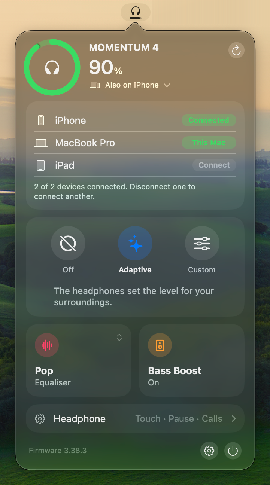

# Momentum Menu

A macOS menu bar app for the Sennheiser MOMENTUM 4.

<!-- One row of three columns, two shots each, paired so the columns end near level. -->
<table>
  <tr>
    <td valign="top" align="center">
      <br>Charging<br><br>
      <br>Headphone settings
    </td>
    <td valign="top" align="center">
      <br>Paired devices<br><br>
      <br>Settings
    </td>
    <td valign="top" align="center">
      <br>Equaliser bands<br><br>
      <br>Disconnected
    </td>
  </tr>
</table>

> [!CAUTION]
> **Unofficial, reverse-engineered, and not notarised.** Use it at your own risk.
>
> - **Unofficial:** not made, endorsed or supported by Sennheiser or Sonova.
> - **Reverse-engineered:** the headphones' control protocol is undocumented. Every command comes from community captures, and a firmware update can change what one does.
> - **Hazardous ids:** some ids reset the link, power the headphones off or erase pairings. The app sends only commands on its allow-list. If you change it, never send anything in `0x06xx` but the battery read: `0x0605` with an empty payload powered them off three times. See [Protocol notes](#protocol-notes).
> - **Not notarised:** the app is ad hoc signed, not signed by an Apple developer or checked by Apple, so macOS blocks its first launch. [Download](#download) says how to verify a release and open it.

## Download

[Releases](https://github.com/agrmohit/momentum-menu/releases) carry a DMG built by GitHub Actions from the tagged commit, with a build provenance attestation and a SHA-256 file. Needs macOS 26 on Apple silicon.

```sh
gh attestation verify MomentumMenu-*.dmg -R agrmohit/momentum-menu
```

The app is ad hoc signed, not notarised, so macOS blocks its first launch whatever the attestation says. Open it once, then choose **Open Anyway** in System Settings > Privacy & Security, or run `xattr -dr com.apple.quarantine /Applications/MomentumMenu.app`.

## Build and run

Needs macOS 26 and Xcode 26 (the Command Line Tools lack the SwiftUI macro plugin and XCTest).

```sh
make install    # builds, signs ad hoc, installs to ~/Applications
make check      # clean build with warnings as errors, then the tests; what CI runs
make            # every target and variable
```

- The ad hoc signature changes on every build, so macOS may ask for Bluetooth permission again after an install.
- Left click for the popover. Right click for Settings, Refresh, Disconnect and Quit.
- The line under the battery opens the paired devices, to connect or disconnect one. Settings sets each device's icon.
- For screenshots, `defaults write com.agrmohit.momentummenu demoDeviceNames -bool YES` shows stock device names until `defaults delete` and a relaunch.
- Settings > App Icon picks Starfield (bundled), Sleepy or Ghost, and the app sets the choice again at launch. A non-default icon adds a Finder attribute that fails `codesign --strict`; the plain check passes.
- The tests need no hardware. `make test` is the quick incremental run; it shows a file's warnings only when it recompiles that file.
- A release is a `v*` tag on a commit whose `build.sh` version matches and which has `docs/releases/<tag>.md`. CI runs first, then the release workflow builds, attests and publishes the DMG.

## Protocol notes

GAIA v3 frames start `FF 03 00 LL`, then the vendor (`0x0495`) and the command id. The feature is `command >> 9`.

| What | Ids | Notes |
| --- | --- | --- |
| Subscribe | `0x0007` | The device pushes nothing for a feature until it is registered. The app registers battery, ANC, EQ, transparency, audio (feature 4) and device management (feature 10). |
| Battery | `0x0603` | Steps of 10 only. HFP and Qualcomm's `001D:1A01` give the same steps, so finer is not possible. |
| Codec | `0x0800` read, `0x0880` push | One byte, Smart Control's enum: 0 SBC, 1 AAC, 2 aptX, 3 aptX LL, 5 aptX HD, 8 aptX Adaptive, 9 aptX Lossless, 10 LC3, `FF` none. 11 is seen but unexplained. |
| Sample rate | `0x089A` push | u32 big-endian Hz. Covers whichever device is streaming. |
| Noise mode table | `0x1A00` | Adaptive is written as an `[id, value]` pair, or the whole table where the pair is rejected; anti-wind always as the whole table. A write can reset the level, so the app skips no-op writes and reads the level back after the rest. |
| EQ and bass boost | `0x10xx` | Firmware 3.x only; 2.x rejects them with `0x05`. |
| Paired devices | `0x1400`-`0x1409`, `0x1484` push | Count, own index, limit (2), then `[index, priority, connected, name, 00]` per index. Addressed by index only, and indexes can reorder, so the list is re-read before any connect (`0x1402`) or disconnect (`0x1403`). |

Safety lives in [`Commands.swift`](Sources/M4Core/Gaia/Commands.swift):

- An allow-list of every id the app sends, with exact payload rules. Anything else is refused before it reaches the radio.
- A deny-list underneath: `0x0607`, `0x0613` and `0x0685` drop the link. `0x0801`, `0x0805` and `0x0817` are setters the app does not use.
- `0x1403` disconnects a paired device on firmware 3.38.3 but erased a pairing on 2.13.42, so it is refused below 3.38.3. The deletes `0x1405` and `0x1406` are never sent.
- Frames for any vendor other than `0x0495` are refused.
- Never sweep id ranges against real headphones.

## Credits

- [andr3-santos/momentum-menu](https://github.com/andr3-santos/momentum-menu): the repo this is forked from.
- [DanSmith888/omarchy-momentum4](https://github.com/DanSmith888/omarchy-momentum4): `PROTOCOL.md`, the presets and the hazard list.
- [gjabell/momentumctl](https://github.com/gjabell/momentumctl): frame format and the captured test vectors.
- [Tumult1337/momentum4-control](https://github.com/Tumult1337/momentum4-control): the GAIA SDP service UUID, EQ payloads, and the multipoint commands and captures.
- [stefanfmeyer/smart-connect-bt-audio](https://github.com/stefanfmeyer/smart-connect-bt-audio): GAIA over BLE and cross-checked ids.

Not affiliated with Sennheiser or Sonova.

## License

[MIT](LICENSE)
